# Diagramas da Central Educacional

Diagramas em Mermaid (o VS Code com a extensão *Markdown Preview Mermaid Support* e o GitHub
desenham direto). Texto e regras em [modulos.md](modulos.md) e [funcionalidades.md](funcionalidades.md).

1. [Contexto](#1-contexto)
2. [Módulos: crescimento horizontal](#2-módulos-crescimento-horizontal)
3. [Implantação](#3-implantação)
4. [Organização do código](#4-organização-do-código)
5. [Modelo de dados](#5-modelo-de-dados)
6. [Ciclo de vida da ficha FLEO](#6-ciclo-de-vida-da-ficha-fleo)
7. [Preencher, enviar e validar](#7-preencher-enviar-e-validar)
8. [Uso sem internet no celular](#8-uso-sem-internet-no-celular)
9. [Importação de arquivos](#9-importação-de-arquivos)
10. [Casos de uso por perfil](#10-casos-de-uso-por-perfil)
11. [Escopo de acesso](#11-escopo-de-acesso)

---

## 1. Contexto

Quem usa a central e de onde vêm os dados externos. Nenhuma integração automática é presumida:
as fontes externas entram por arquivo autorizado (M09).

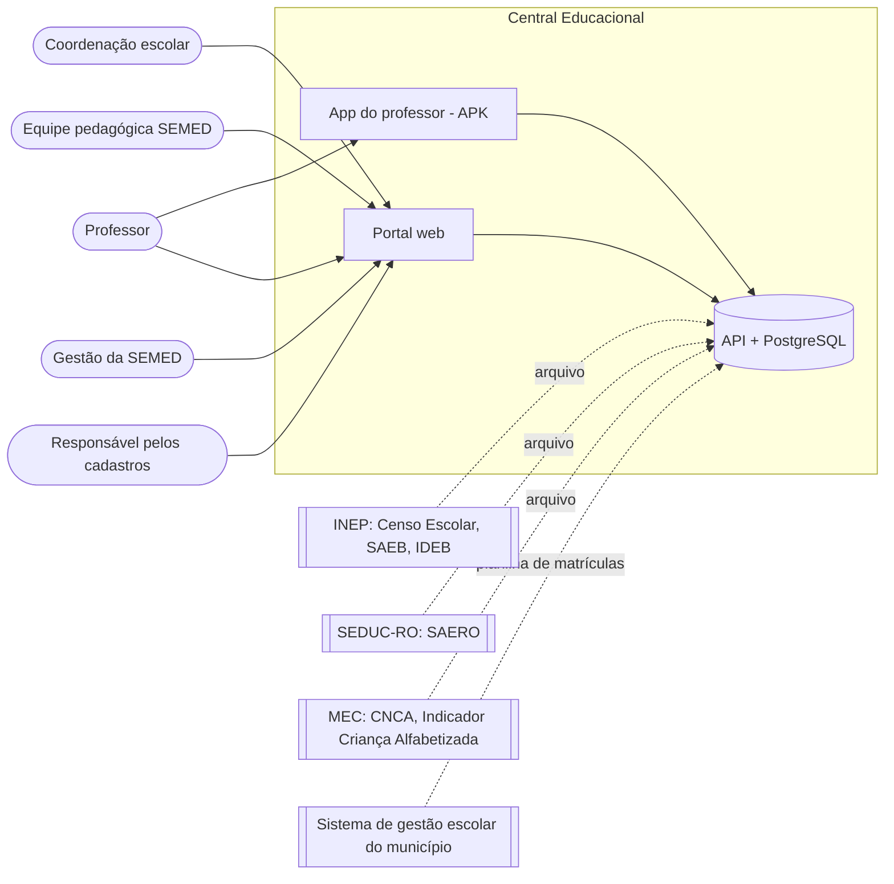

## 2. Módulos: crescimento horizontal

Plataforma embaixo, módulos lado a lado em cima. Cada módulo depende **só da plataforma**. Entre
módulos, só leitura opcional por visão publicada (linha pontilhada).

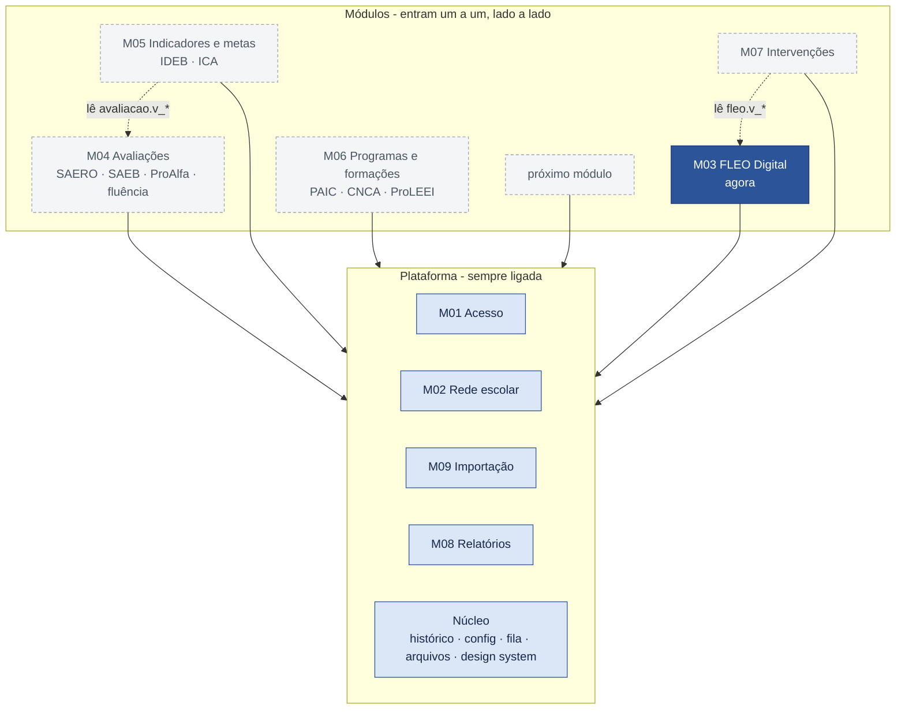

Legenda: azul escuro = primeiro módulo (FLEO); azul claro = plataforma; tracejado = módulos que
entram depois, na ordem que a secretaria decidir.

### 2.1 Registro de módulos

Como a central se monta sozinha a partir dos módulos ligados:

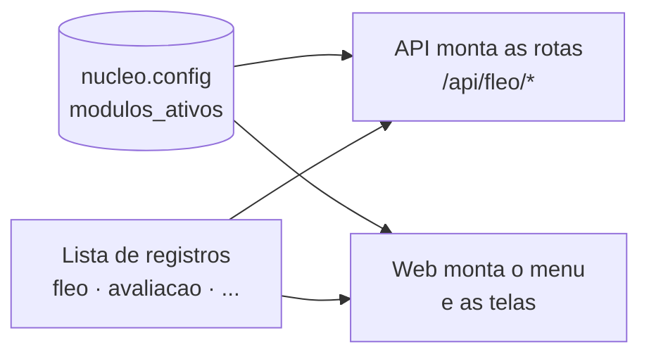

## 3. Implantação

Mesmo padrão do Reurb: imagens construídas na máquina de desenvolvimento, carregadas no servidor
(`docker save | ssh docker load`) e publicadas como stack no Portainer.

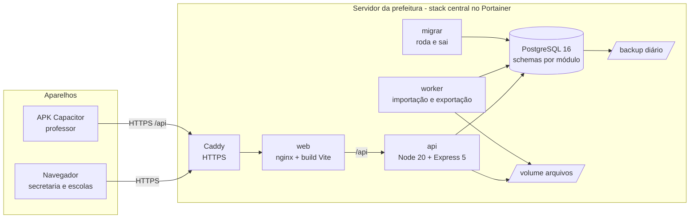

## 4. Organização do código

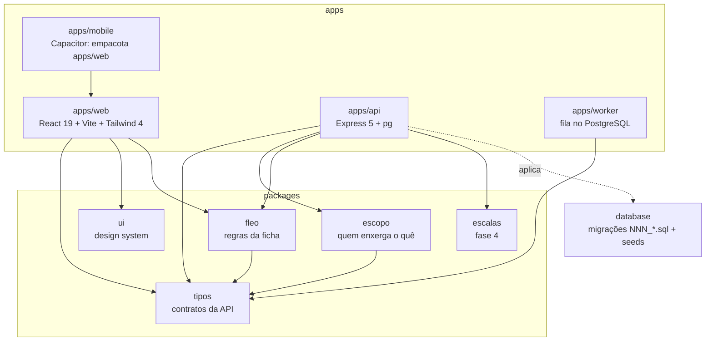

## 5. Modelo de dados

### 5.1 Acesso e rede (M01, M02)

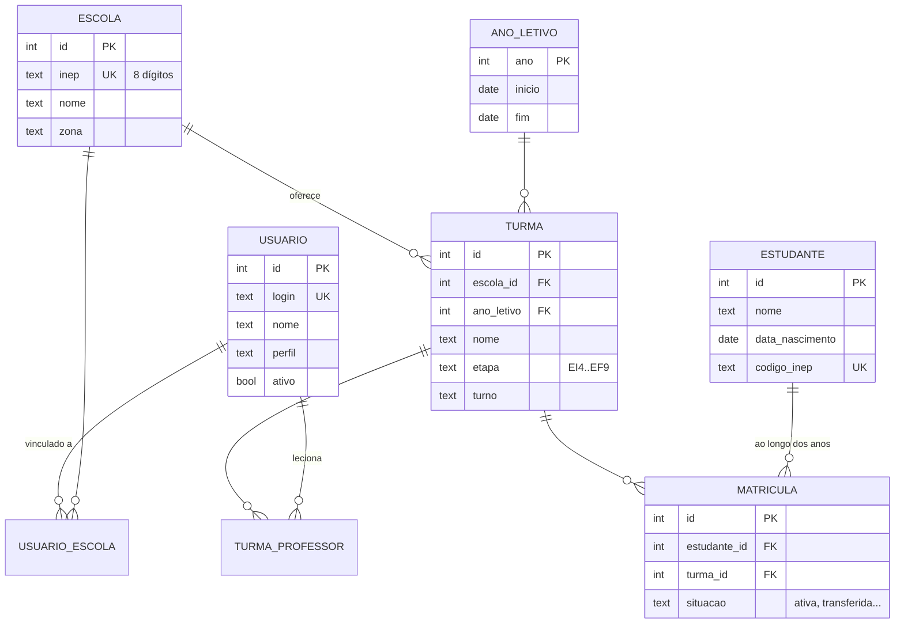

### 5.2 FLEO (M03)

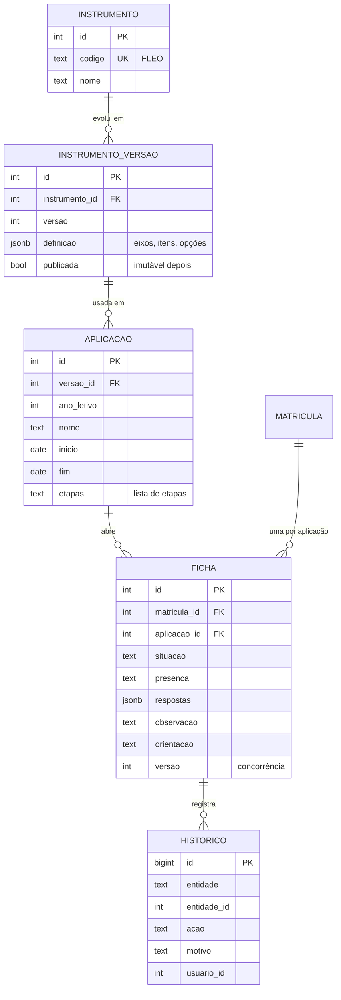

### 5.3 Avaliações e indicadores (M04, M05)

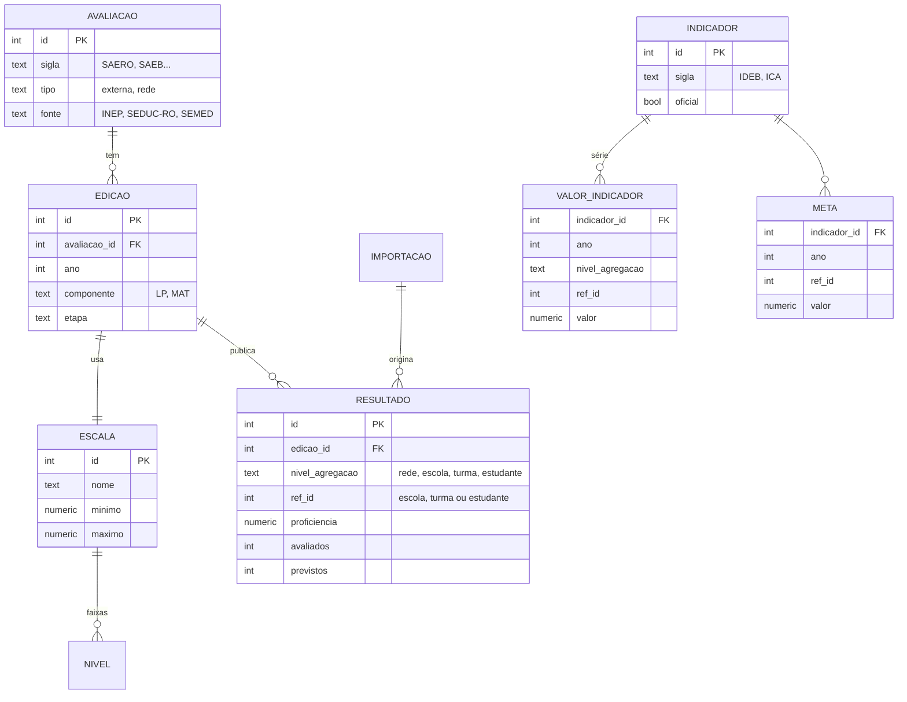

### 5.4 Programas e intervenções (M06, M07)

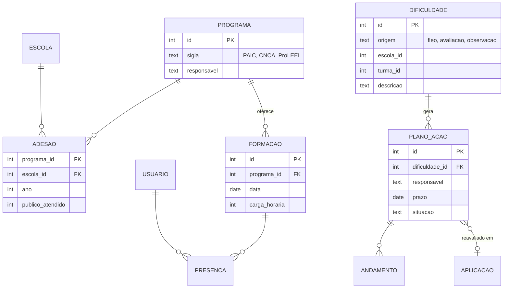

## 6. Ciclo de vida da ficha FLEO

Regras em `packages/fleo` (função `transicionar`). "Não iniciada" é a ficha em rascunho sem
nenhuma resposta; não é uma situação gravada.

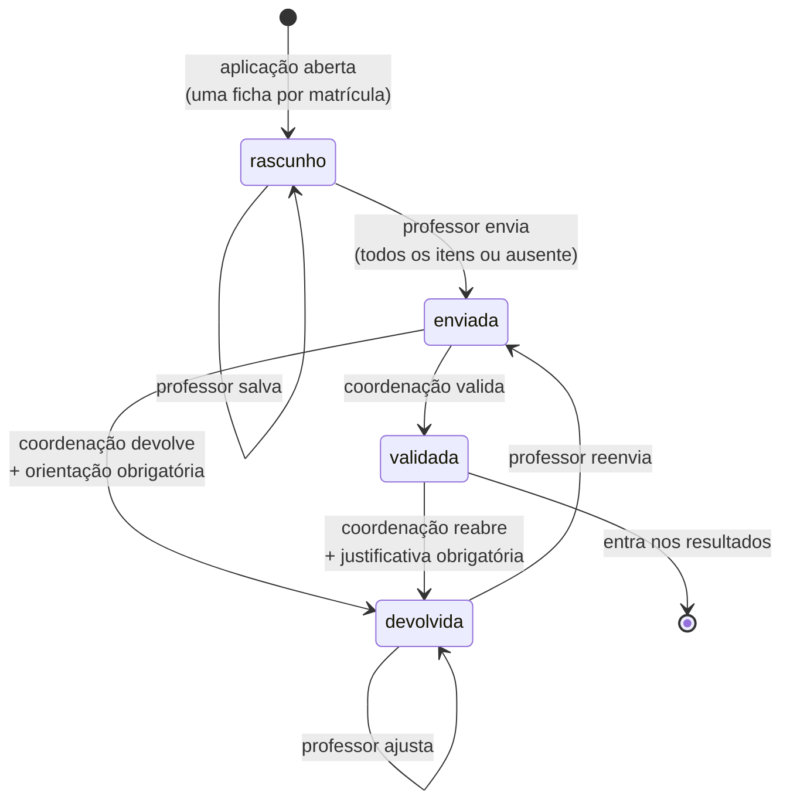

## 7. Preencher, enviar e validar

Controle de concorrência: toda escrita manda a `versao` lida; se outra pessoa mudou antes, a API
responde 409 e a tela pede para recarregar.

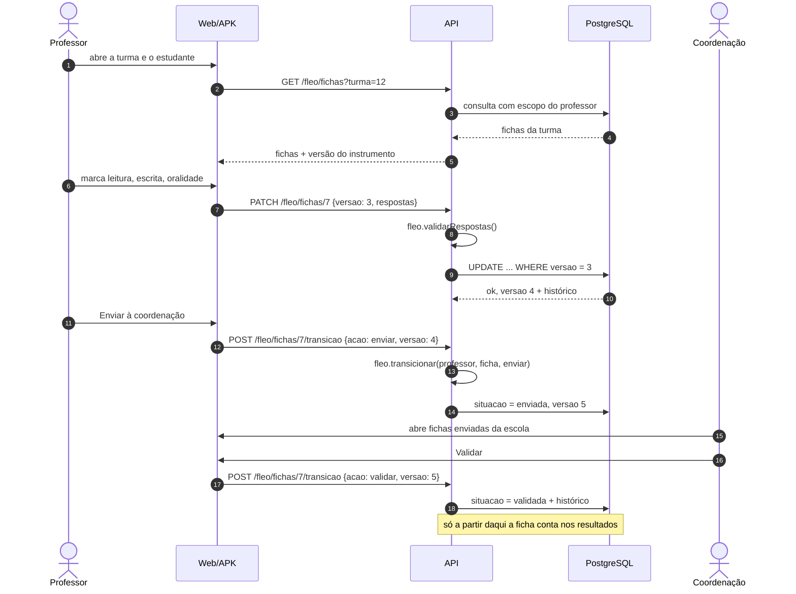

## 8. Uso sem internet no celular

Mesmo modelo do app do Social no Reurb: rascunho cifrado no aparelho (IndexedDB), fila de envio
e conferência no servidor ao reconectar. Sincronizado **não** é validado.

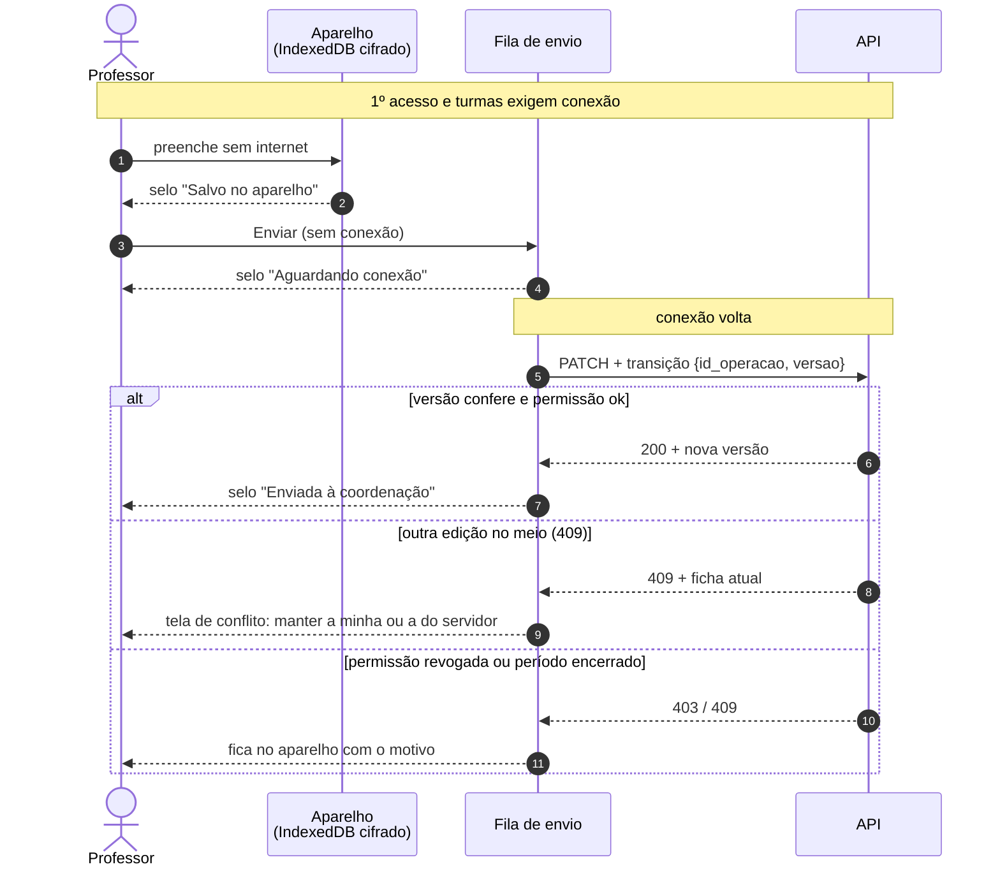

Selos na tela (UC-F19):

| Selo | Significa |
|---|---|
| Salvo no aparelho | só neste celular |
| Aguardando conexão | na fila, sai sozinho |
| Sincronizado | rascunho chegou ao servidor |
| Enviada à coordenação | aguardando conferência |
| Validada | conta nos resultados |

## 9. Importação de arquivos

Repetível sem duplicar: cada tipo de arquivo tem uma chave natural (ex.: INEP da escola + nome da
turma + ano; ID do estudante + edição).

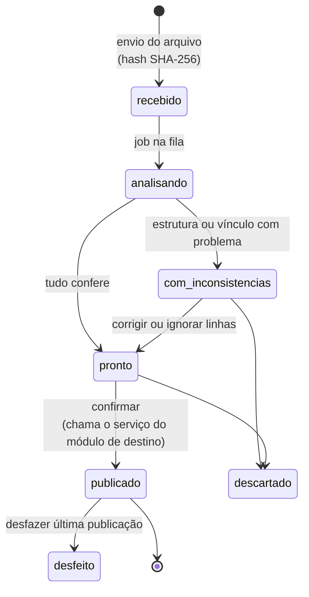

## 10. Casos de uso por perfil

Códigos em [funcionalidades.md](funcionalidades.md). Só o que entra no piloto da FLEO.

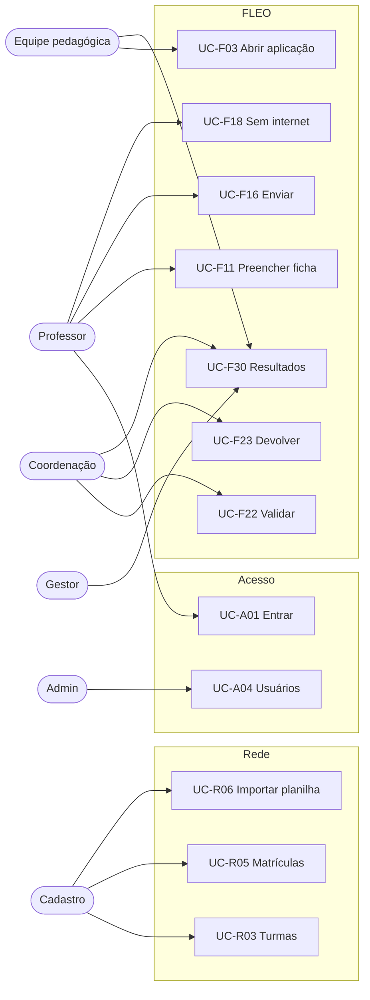

## 11. Escopo de acesso

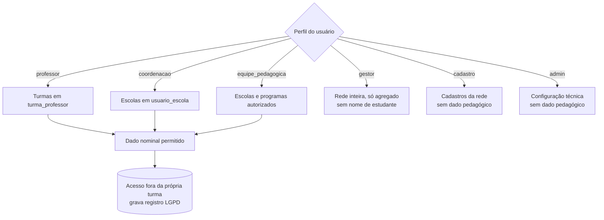
